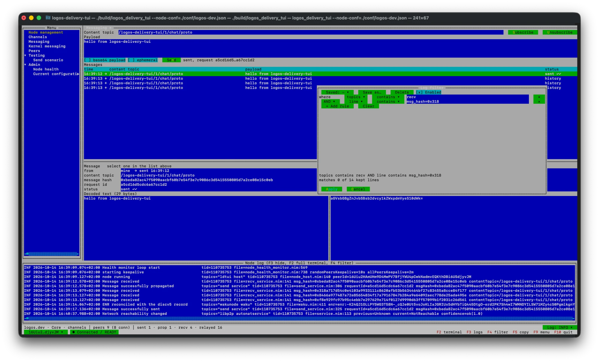
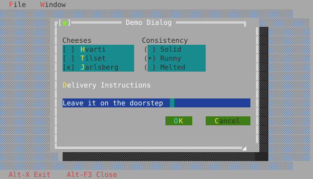
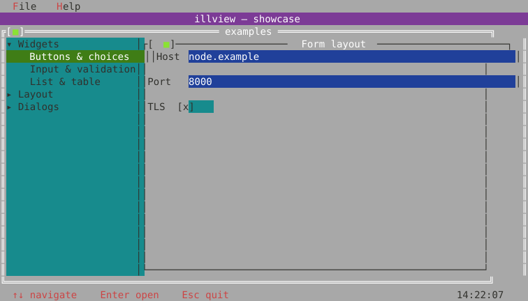
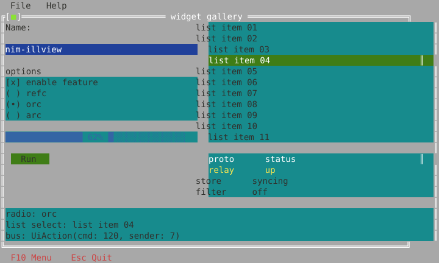

# illview

**Turbo Vision for Nim, on chronos.** Windows, menus, tables, trees, tabs and
forms — a retained-mode TUI framework that lives on your app's async loop,
with a declarative macro DSL and typed [nim-brokers](https://github.com/NagyZoltanPeter/nim-brokers)
events.

 
 



*A real app built on illview: the Logos Delivery node console — messaging
view, live node log and a rule-based log filter dialog, all on the node's own
chronos loop.*

## Why illview

- **Embeds in a live async daemon.** One chronos thread, input via
  `addReader2` (no polling), dirty-driven fps-capped rendering, zero timers
  when idle. Turn the TUI on and off at runtime; capture stdout/stderr while
  it is up.
- **Declarative UI.** Describe a screen as a pragma-annotated type —
  `mount(T)` builds layout, captions, styling, handlers and two-way state
  binding.
- **Typed, decoupled events.** Widgets emit auto-generated nim-brokers
  events; models drive widgets through signals. No widget references in your
  model code.
- **Turbo Vision look and feel.** Overlapping, draggable windows, menus with
  `~tilde~` accelerators, dialogs, tabs, mouse everywhere.
- **Testable without a terminal.** 376 tests from the escape-sequence
  decoder to cell-exact render snapshots, CI-gated on macOS and Linux under
  ORC and refc, plus ASAN.

## Taste

```nim
import chronos, illview, illview/dsl/uievents

type
  LoginForm {.view, vbox, spacing: 1.} = ref object of Group
    user {.child, bindValue: "userVal".}: Input
    pass {.child, bindValue: "passVal", border: bkSingle, boxTitle: "secret".}: Input
    login {.child, caption: "~L~ogin", emits: "LoginRequested".}: Button
    userVal, passVal: string

uiEvents(LoginForm) # generates the typed LoginRequested broker event

proc main() {.async.} =
  let app = newApp()
  let win = newWindow("sign in", rect(10, 3, 40, 12))
  let form = mount(LoginForm)
  form.dock = dkFill
  win.add form
  app.desktop.add win
  await app.run() # Ctrl+C quits

waitFor main()
```







*All but the first image are rendered by illview itself, off-screen,
cell for cell (`nimble screenshots`).*

## Install

```sh
nimble install illview
```

POSIX terminals (macOS, Linux); Windows compiles but has no input driver yet.

## Learn more

| | |
| --- | --- |
| [**Cookbook**](docs/COOKBOOK.md) | copy-paste recipes: forms, binding, validation, async model code, menus, scrolling, testing, custom widgets |
| [**Reference**](docs/REFERENCE.md) | every pragma, widget, slot, event, signal and option |
| [**Design**](docs/DESIGN.md) | architecture, dataflow, embedding in a host, output capture, extending, build & test |
| [**Examples**](examples/) | `nimble examples` — from a raw input echo to the full showcase (`ex13_showcase`) |

## Kudos

illview stands on [illwill](https://github.com/johnnovak/illwill) by
John Novak ([@johnnovak](https://github.com/johnnovak)): its double-buffered
`TerminalBuffer` and diffing `display()` are the rendering layer underneath
every illview frame. Thank you, John!

## License

MIT — see [LICENSE](LICENSE). The vendored illwill is WTFPL by John Novak
([LICENSE-illwill](LICENSE-illwill)).
