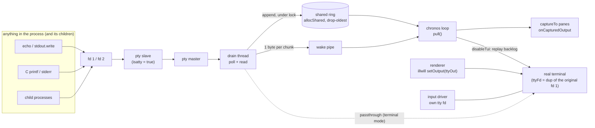

# illview design

illview is a retained-mode, Turbo Vision-inspired TUI widget library for Nim.
It renders through a vendored [illwill](https://github.com/johnnovak/illwill),
runs on a single-thread [chronos](https://github.com/status-im/nim-chronos)
event loop that it shares with its host, routes input itself, and talks to
the rest of the program over [nim-brokers](https://github.com/NagyZoltanPeter/nim-brokers).
A declarative macro layer turns annotated object types into mounted widget
trees.

This document covers how the pieces fit together, how to embed and extend
the library, and how to build and test it. Usage recipes live in
[COOKBOOK.md](COOKBOOK.md), the API listing in [REFERENCE.md](REFERENCE.md),
and the decision log in [design-notes/](design-notes/DESIGN-DEVIATIONS.md).

**Contents**

1. [Overview & layers](#1-overview--layers)
2. [Module map](#2-module-map)
3. [Frame loop & rendering](#3-frame-loop--rendering)
4. [Input pipeline & routing](#4-input-pipeline--routing)
5. [Dataflow: model / view / control](#5-dataflow-model--view--control)
6. [Broker contexts](#6-broker-contexts)
7. [Embedding in a host](#7-embedding-in-a-host)
8. [Output capture](#8-output-capture)
9. [Extending illview](#9-extending-illview)
10. [Memory model & platform support](#10-memory-model--platform-support)
11. [Build, test & CI](#11-build-test--ci)
12. [Design notes](#12-design-notes)

## 1. Overview & layers

Each layer depends only on the layers below it. The umbrella module
`src/illview.nim` re-exports core, layout, widgets, the decoder,
`dsl/pragmas`, `dsl/mount` and `vocab`. `illview/bus_brokers` and
`illview/dsl/uievents` are imported explicitly (they expand broker macros the
default import graph does not need), as are backend internals such as
`illview/backend/illwill_vendored`.

```text
 ┌──────────────────────────────────────────────────────────────────────────┐
 │ vocab.nim            framework events (Clicked, TextChanged, …) and      │
 │ bus_brokers.nim      signals (SetText, FocusMe, …); nim-brokers EventBus │
 ├──────────────────────────────────────────────────────────────────────────┤
 │ dsl/                 pragmas · mount(T) · uiEvents(T) · ui(g): body      │
 ├──────────────────────────────────────────────────────────────────────────┤
 │ widgets/             Desktop, Window, Button, Input, Table, TreeView, …  │
 ├──────────────────────────────────────────────────────────────────────────┤
 │ layout/              HBox / VBox / Grid / Form, distribute(), alignment  │
 ├──────────────────────────────────────────────────────────────────────────┤
 │ core/                App + frame loop · View/Group · routing · events    │
 │                      DrawContext · theme · bus · text width · selection  │
 ├──────────────────────────────────────────────────────────────────────────┤
 │ backend/             vendored illwill (TerminalBuffer, diffed display)   │
 │                      escape-sequence decoder · POSIX input driver        │
 │                      output capture · emoji-width probe                  │
 └──────────────────────────────────────────────────────────────────────────┘
        ▲ terminal bytes in (tty fd)              │ diffed cells out (illwill output())
```

Five invariants hold the design together:

1. Vendored illwill is the "hardware layer": a `TerminalBuffer` and a diffed
   `display()`. Nothing else writes cells to the terminal.
2. Input bytes go through a pure, incremental decoder fed by a chronos
   reader on a dedicated tty fd. No polling.
3. `frame()` is blocking and single-shot: arrange → draw (clipped
   `DrawContext`) → display. It runs on demand, capped at `fpsCap`.
4. Routing delivers content-local coordinates, and parents draw child
   decoration (border, title, shadow), so drawing and hit-testing agree.
5. Handlers mutate state and call `invalidate()`; the next frame shows it.

## 2. Module map

Paths are relative to `src/illview/`.

| Path | Responsibility | Key public types / procs |
| --- | --- | --- |
| `../illview.nim` | Umbrella: re-exports core, decoder, layout, widgets, `dsl/pragmas`, `dsl/mount`, `vocab` | — |
| `backend/illwill_vendored.nim` | Vendored illwill with local patches (renderer output handle, alternate screen for every capable `TERM`, suspend/resume sequences) | `TerminalBuffer`, `newTerminalBuffer`, `display`, `setOutput`, `output`, `Key`, `ForegroundColor`, `BackgroundColor` |
| `backend/decoder.nim` | Incremental escape-sequence decoder: keys, SGR mouse, bracketed paste | `Decoder`, `feed`, `flush`, `pendingBytes` |
| `backend/driver_posix.nim` | Async input driver: tty fd + chronos `addReader2`, SIGWINCH self-pipe | `InputDriver`, `newInputDriver`, `start`, `stop` |
| `backend/driver_fallback.nim` | Non-POSIX stub: `start` raises `OSError` | same API |
| `backend/capture_posix.nim` | stdout/stderr capture via pty + drain thread | `OutputCapture`, `newOutputCapture`, `start`, `stop`, `setPassthrough`, `pull`, `pending`, `captureCrashFds`, `captureCrashDump` |
| `backend/ansitext.nim` | Escape stripping and replay sanitising for captured output | `sanitizeForReplay`, `stripAnsi`, `LineSplitter`, `feed` |
| `backend/probe_posix.nim` | Measures the terminal's emoji width (DSR 6) | `probeEmojiWidth` |
| `core/app.nim` | App context, demand-scheduled frame loop, TUI lifecycle, modal loop, crash/signal restore, capture wiring | `App`, `newApp`, `run`, `stop`, `frame`, `requestRedraw`, `enableTui`, `disableTui`, `tuiActive`, `execView`, `endModal`, `focus`, `enableCommand`, `disableCommand`, `isCommandEnabled`, `captureTo`, `capturedOutput`, `CaptureSupported` |
| `core/view.nim` | `View` / `Group` base, the method contract, app services via root closures, broker ctx, `dispose` | `View`, `Group`, `Event`, `EventKind`, `BorderKind`, `initView`, `invalidate`, `publish`, `runModal`, `endModal`, `captureMouse`, `releaseMouse`, `brokerCtx`, `hasBrokerCtx`, `sessionCtx`, `deferWiring`, `dispose`, `add`, `remove`, `raiseToTop`, `styleOf`, `hotkeyStyle` |
| `core/routing.nim` | Pure view-tree routing: hit test, focus chain, key bubble, Tab, hotkeys | `hitTest`, `dispatchMouse`, `dispatchKey`, `dispatchPaste`, `dispatchHotkey`, `setFocus`, `focusNext`, `focusPrev`, `focusInto`, `focusedLeaf`, `canFocus` |
| `core/events.nim` | Backend input events | `InputEvent`, `InputKind`, `Modifier`, `MouseAction`, `MouseButton`, `keyEvent`, `mouseEvent` |
| `core/geometry.nim` | Geometry and size hints | `Point`, `Rect`, `SizeHint`, `Dock`, `Align`, `Anchor`, `rect`, `fixedHint`, `prefHint` |
| `core/drawcontext.nim` | Clipped, translated drawing onto a `TerminalBuffer` | `DrawContext`, `initDrawContext`, `sub`, `write`, `putCell`, `fill`, `box`, `shade` |
| `core/theme.nim` | Styles, theme tokens, palettes | `Style`, `ThemeToken` (`tk*`), `Palette`, `Theme`, `tvTheme`, `defaultTheme`, `classicBlueTheme`, `variant` |
| `core/bus.nim` | Commands and the open EventBus (tier-2 actions + string-topic domain events) | `Command`, `cmdNone`, `cmOk`/`cmCancel`/`cmYes`/`cmNo`, `UiAction`, `EventBus`, `StubBus`, `NullBus`, `newNullBus`, `newStubBus`, `subscribeDomain`, `publishDomain` |
| `core/textwidth.nim` | Terminal column width (wide, zero-width, emoji) | `runeWidth`, `textWidth`, `clipWidth`, `sliceCols`, `setEmojiWidth` |
| `core/hotkey.nim` | `~F~ile` tilde accelerator parsing | `parseHotkey`, `hotkeyMatches` |
| `core/selection.nim` | Text selection shared by Editor / Input / TextView | `TextPos`, `selectedText` |
| `core/clipboard.nim` | Copy via OSC 52 and the OS tool | `copyToClipboard` |
| `layout/layout.nim` | Layout containers and space distribution | `BoxLayout`, `newHBox`, `newVBox`, `Grid`, `newGrid`, `FormLayout`, `newFormLayout`, `distribute` |
| `widgets/*.nim` | Widget set (one file each): `Desktop`, `Window`, `Label`, `Button`, `Checkbox`, `TriStateCheckBox`, `Radio`, `Input`, `Editor`, `ListView`, `Table`, `TreeView`, `TextView`, `GroupBox`, `ProgressBar`, `Sparkline`, `ScrollBar`, `Scroller`, `Splitter`, `TabView`, `StatusBar`, `ControlBar`, `MenuBar`/`ContextMenu`, `NetVizWidget`; `dialogs.nim` (`messageBox`, `confirm`, `inputBox`); `hbar.nim` (shared horizontal scroll bar) | `new<Widget>` constructors |
| `dsl/pragmas.nim` | DSL pragmas (each a `{.pragma.}` template) | `view`, `child`, `hbox`, `vbox`, `grid`, `form`, `bindValue`, `emits`, `on`, … |
| `dsl/mount.nim` | `mount(T)` macro and its per-widget extension overloads | `mount`, `ui`, `createView`, `setCaption`, `bindSlot`, `bindValueSlot`, `widgetValue`, `uiValueKind` |
| `dsl/uievents.nim` | `uiEvents(T)`: typed broker events, request brokers, `set<Field>` / `notify<Field>` writers | `uiEvents` |
| `vocab.nim` | Framework event / signal vocabulary on each widget's instance ctx | `Clicked`, `TextChanged`, `Submitted`, `Toggled`, `StateChanged`, `SelectionChanged`, `Activated`; `SetText`, `SetChecked`, `SetCheckState`, `SetSelected`, `SetProgress`, `FocusMe`; `installSignal`, `installFocusMe`, `CheckState` |
| `bus_brokers.nim` | nim-brokers implementation of `EventBus` | `BrokersBus`, `newBrokersBus`, `onUiAction`, `onDomainEvent` |

## 3. Frame loop & rendering

Rendering is dirty-flag driven and demand-scheduled (`core/app.nim`).

```text
 handler mutates state
        │
        ▼
 v.invalidate() ──► root Group.invalidateCb ──► app.requestRedraw()
                                                 │ dirty = true
                                                 ▼
                                           scheduleFrame()  (no-op if one is pending
                                                 │           or the TUI is off)
                                                 ▼
                          frameSoon: sleep the rest of 1000/fpsCap ms since lastFrame
                                                 │
                                                 ▼
 frame():  resize/clear TerminalBuffer ─► desktop.arrange(screen rect)
           ─► desktop.draw(initDrawContext(tb)) ─► onRender hook ─► tb.display()
```

| Property | Mechanism |
| --- | --- |
| Idle cost | zero: no ticker; a frame task exists only while a redraw is pending |
| Rate cap | `newApp(fpsCap = 30)`; any number of `invalidate()` calls within one period coalesce into one frame |
| Layout | `arrange` runs every frame (cheap at TUI scale); resize reflow is free |
| Clipping | `DrawContext.sub(r)` translates and intersects; a widget cannot paint outside its content rect |
| Decoration | `Group.draw` draws each child's shadow, border and title, then calls `child.draw` on the child's content area, then `drawOverlay` on its full rect |
| Output | `display()` diffs against the previous frame; `frame()` is the only caller |
| Failure | an `IOError` from a frame is swallowed; the next redraw retries |
| Re-entry | `enableTui()` invalidates the diff cache, so the first frame after re-entry repaints everything |

`app.onRender(tb)` draws over the tree after it is drawn; `app.onInput(ev)`
observes every input event after routing. Both are escape hatches, not the
normal path.

Offscreen rendering needs no terminal: build a tree, then
`d.draw(initDrawContext(newTerminalBuffer(w, h)))` and inspect `tb[x, y]`.
`tests/test_render_snapshot.nim` and `tools/screenshots.nim` both do this.

## 4. Input pipeline & routing

```text
 tty fd (O_NONBLOCK) ──addReader2──► drain bytes ──► Decoder.feed ──► seq[InputEvent]
 SIGWINCH ──► handler writes 1 byte ──► self-pipe ──addReader2──► ikResize
                                                                    │
                                     App.handleInput ◄──────────────┘
                                       ikKey    → dispatchKey(scope, ev)
                                       ikMouse  → click counting → dispatchMouse(scope, ev, clicks)
                                       ikPaste  → dispatchPaste(scope, text)
                                       ikResize → capture.syncSize, requestRedraw
                                       then app.onInput(ev)
```

**Driver** (`backend/driver_posix.nim`). It opens the tty's real device name
(`ttyname` of fd 0, 1 or 2) as a separate read fd. `O_NONBLOCK` on fd 0 would
also apply to stdout, which shares fd 0's file description, and frame writes
would fail with `EAGAIN`. `/dev/tty` is not used because macOS kqueue refuses
to watch it. Raw mode still applies: termios is per device. The fallback is
stdin with `O_NONBLOCK`. The decoder is incremental: a sequence split across
reads is completed on the next read.

**Scope.** Every dispatch takes a scope `Group`: the desktop, or the topmost
modal view while one is open. Events never leave the scope.

| Input | Routing (`core/routing.nim`) |
| --- | --- |
| Mouse | If a view holds the mouse capture (`captureMouse`), it gets everything until release; a bare motion with no button also ends the capture (1003 mode often reports release that way). Otherwise `hitTest` walks children topmost-first, recursing into groups, and delivers target-content-local coordinates. Unconsumed events bubble parent-ward, re-translated, up to the scope. A press raises every floating (`dkNone`) view on the path, except children of layout containers (`keepsChildOrder`) and docked views, and focuses the target or the clicked window. `clicks` carries double-click detection. |
| Key | Delivered to the focused leaf (`focusedLeaf`), bubbling to the scope. Unconsumed Tab / Shift-Tab moves focus (`focusNext` / `focusPrev`) through the scope's focusable views; unconsumed Alt+letter goes to `dispatchHotkey`, which triggers the first visible view whose accelerator matches. |
| Paste | Focused leaf, bubbling to the scope. |
| Focus | The focus is the chain `Group.focused` from the scope down; `app.focus` derives the leaf. Stale `focused` fields on other branches are each group's "last focused child" memory, used when a window is re-activated. `canFocus` requires visible, enabled, focusable, and every ancestor visible. |

**Modal scopes.** `app.execView(g)` adds `g` to the desktop, raises it,
pushes it on the modal stack with the current focus, focuses into it and
returns a `Future[Command]`. `endModal(cmd)` pops it, removes it, restores the
previous focus and completes the future. No nested event loop runs; widgets
reach this through `v.runModal(g)` / `v.endModal(cmd)`.

## 5. Dataflow: model / view / control

Three channels, each one-directional. The model side never holds a widget
reference.

| Direction | Channel | Carrier |
| --- | --- | --- |
| widget → app (intent) | `emits: "Name"` (via `uiEvents(T)`), `item(label, EventType)` menu actions | typed nim-brokers `EventBroker` event on `app.sessionCtx`, carrying `senderId` and a value snapshot; a controller never needs a `View` |
| widget → model (state) | `bindValue: "field"` / `"model.field"` | stored on the view, or on a `ref` model the view holds; `bindRequest: "Name"` routes through a replaceable `RequestBroker` validator |
| model → widget | `set<Field>` writer, `notify<Field>`, or a vocab signal (`SetText.signal(w.brokerCtx, …)`) | `SignalBroker` on the widget's instance ctx; a stale handle returns `err`; signal application never fires change slots or re-emits |

Below these, two older tiers remain: closure slots on each widget
(`Button.onClick`, `Input.onChange`, …) and the `EventBus` (`UiAction`
commands via `publish`, string-topic domain events via `publishDomain` /
`subscribeDomain` with `prefix/*` wildcards). Every channel ends in
`invalidate()` and one frame. State mutated behind the framework's back
repaints only after `notify<Field>` or a signal. Recipes:
[COOKBOOK.md §3–§8](COOKBOOK.md#3-reacting-to-a-click--pick-the-right-tier).

## 6. Broker contexts

Two kinds of `BrokerContext` route illview traffic.

| Context | Accessor | Carries | Lifetime |
| --- | --- | --- | --- |
| Session ctx | `app.sessionCtx`, `v.sessionCtx` | `emits:` events, `item(label, EventType)` menu events — app-level semantics | captured per view at `initView` (its class, instance id 0) |
| Instance ctx | `v.brokerCtx` | vocab events out (`Clicked`, `TextChanged`, …), vocab signals in (`SetText`, `FocusMe`, …) — exactly one widget | allocated on first `brokerCtx` call; inert (`BrokerContext(0)`) after `dispose()` |

**Session resolution** (`newApp`, `core/app.nim`). `newApp` adopts the
thread's `globalBrokerContext()` and never installs one, so the UI shares the
scope the host already keys its brokers on.

| Situation | `app.sessionCtx` | thread global ctx after `newApp` |
| --- | --- | --- |
| bare thread, `newApp()` | `DefaultBrokerContext` | unchanged |
| host called `setThreadBrokerContext(nodeCtx)` earlier | `nodeCtx` | unchanged |
| `newApp(sessionCtx = uiCtx)` | `uiCtx`, also for views built afterwards | unchanged |
| two UIs in one process | pass each its own `sessionCtx` | unchanged |

A host listener written before the UI existed —
`SomeEvent.listen(globalBrokerContext(), …)` — hears UI events without
knowing illview is there. Construction order (host first or UI first) does
not matter: both read the same thread-global value.

**Instance materialization.** A view costs no instance id until someone asks
for `brokerCtx`. `installSignal` / `installFocusMe` are deferred
(`deferWiring`) and run when the ctx materializes; widgets emit vocab events
only `if v.hasBrokerCtx` (nobody can be listening otherwise). Instance ids are
not reclaimed on `dispose()`, so build transient views (dialogs, popups) once
and `add` / `remove` them rather than churning new ones.

## 7. Embedding in a host

**The loop is the host's.** `App.run()` is an ordinary `{.async.}` proc: it
calls `enableTui()`, awaits a quit future, and calls `disableTui()` in
`finally`. It never calls `waitFor` / `runForever` and never owns the
dispatcher.

```nim
let node = await Waku.new(conf)      # host, on the loop
let app  = newApp()                  # UI, same loop, same thread
buildScreen(app)
asyncSpawn app.run()                 # or `await app.run()` if the UI is the program
await node.start()
```

**Loop-thread-only.** Every illview call must happen on the loop thread.
With threads on, `frame()` and the input callback assert it
(`assertLoopThread`). A host worker thread that has something to show
forwards it to the loop thread with its own nim-brokers multi-thread
broker; the listener then touches widgets. illview has no cross-thread
primitive.

**Reaching a widget from the host** goes through vocab signals on the
widget's instance ctx; a stale handle just returns `err`
(`examples/ex10_instance_ctx.nim`):

```nim
discard SetText.signal(peerLabel.brokerCtx, SetText(text: $peers))
discard SetProgress.signal(rateBar.brokerCtx, SetProgress(value: pct))
```

**Daemon mode: TUI on and off.** `enableTui` / `disableTui` are re-entrant.
Disabled, the app is headless: no reader registered, no timers, zero cost; the
widget tree stays alive. Re-enabling repaints the whole screen.
`examples/ex14_logpane.nim` switches with F2 (`disableTui`, logs stream to the
terminal) and Enter (`enableTui`). To keep what other code printed while the
desktop was up, turn on [output capture](#8-output-capture).

**Terminal restore.** Unless built with `-d:noCrashRestore`, `enableTui`
installs (POSIX):

| Trigger | Behaviour |
| --- | --- |
| SIGSEGV, SIGABRT, SIGBUS, SIGILL, SIGFPE | restore the terminal (mouse off, paste off, cursor on, leave alt screen, reset attributes, cooked termios), dump the not-yet-shown captured output, chain to the previous handler |
| SIGTERM, SIGHUP, SIGQUIT | restore without the dump, chain; under the default action the signal is re-raised, so the exit status is preserved (143 for SIGTERM) |
| SIGINT (Ctrl+C) while the TUI is up | one byte on a self-pipe → the loop calls `app.stop()` → `run`'s `finally` restores the terminal. A second SIGINT before that restores in the handler and chains. `disableTui` re-installs the previous SIGINT action |
| unhandled Nim exception (`onUnhandledException`) | restore, write the captured tail, then the traceback (or hand it to a previously installed hook); exit status 1 |
| Ctrl+Z / `fg` | illwill's SIGTSTP / SIGCONT handlers leave and re-enter alt screen, mouse and paste modes; SIGCONT only re-enters when in the foreground process group |

All handlers chain to what was installed before (a host crash reporter,
Nim's traceback handler) and use only `write(2)`, `tcsetattr`, `sigaction`
and `kill` — no GC memory. Tests: `tests/test_app.nim`.

**Default bus.** `app.bus` is a `NullBus`: `UiAction`s go nowhere, domain
topics dispatch to subscribers synchronously, nothing is recorded, so a
long-running process accumulates no history. `app.bus = newBrokersBus()`
(`import illview/bus_brokers`) routes both tiers over nim-brokers on the same
loop. Tests that assert on publishes use `newStubBus()`.

## 8. Output capture

While the desktop is on screen it owns the terminal's alternate screen.
Anything else writing to fd 1 or fd 2 — `echo`, a C library's `printf`, a
child process, a logger on stderr — would garble the UI and vanish when the
alternate screen is left. Capture collects that output instead, can show it
live in a pane, and replays it into the normal scrollback when the desktop is
left.

### 8.1 Usage

```nim
let app = newApp(captureOutput = true)  # opt-in; default off
let pane = newTextView(maxLines = 500)
app.captureTo(pane)                     # optional: live, one line per captured line
app.onCapturedOutput = proc(chunk: string) {.gcsafe, raises: [].} =
  discard                               # optional: raw bytes as they arrive
app.captureLimit = 4 shl 20             # optional: replay history (default 1 MiB)
await app.run()
```

| Call | Effect |
| --- | --- |
| `newApp(captureOutput = true)` / `app.captureOutput = true` before `run` | capture starts with the first `enableTui()` and ends when `run` returns |
| `app.captureTo(tv)` | feeds `tv` line by line, escapes stripped; several panes may be attached |
| `app.onCapturedOutput` | raw chunks, on the loop thread |
| `app.capturedOutput()` | captured bytes not yet shown on the real terminal |
| `app.captureLimit` | ring size in bytes; oldest output is dropped beyond it |
| `app.disableTui()` | leave the desktop: replay the backlog into the scrollback, then pass output through live |
| `app.enableTui()` | back to the desktop: collect again |
| `CaptureSupported` (const) | `true` on POSIX with threads; elsewhere the option is a no-op |

Reference: `examples/ex14_logpane.nim` (F2 terminal mode, Enter back, Esc
quits); chronicles and plain stdout/stderr writes appear both in the pane and
in the scrollback. Recipe: [COOKBOOK.md §26](COOKBOOK.md#26-keep-stdoutstderr-while-the-tui-is-up).

### 8.2 Architecture



| Design choice | Reason |
| --- | --- |
| The renderer writes only through illwill's `output()` handle, never fd 1 | fd 1 feeds the capture. Every terminal write — cells, cursor positioning, colours, alt-screen and mouse switches, flushes — goes to one handle, pointed at a dup of the real terminal. **New renderer code must write through `output()`.** |
| A pty, not a pipe | programs check `isatty(1)`; through a pipe they drop colours and C stdio switches to full buffering |
| A drain thread, not the loop | a pty holds very little before a writer blocks (1024 bytes on macOS, ~4 KiB on Linux); if the loop were the reader, one large synchronous write from the loop thread itself would deadlock |
| One pty for both fds | stdout and stderr stay in order relative to each other |

**Resources** (`backend/capture_posix.nim`):

| Resource | Created → released | Notes |
| --- | --- | --- |
| `ttyFd` / `ttyOut` (dup of the original fd 1) | `start` → `stop` | renderer, replay and passthrough target |
| `savedOut`, `savedErr` (dups of fd 1, fd 2) | `start` → `stop` | put back over fd 1/2 by `stop` and by the crash handler |
| pty master / slave | `start` (`posix_openpt`); slave `dup2`'d over fd 1/2 and closed | children inherit the slave; window size synced on resize and on passthrough |
| shared state + ring | `start` (`createShared` / `allocShared0`) → `dispose` | plain memory behind a `Lock`, no GC types |
| drain thread | `start` (`createThread`) → `stop` (stop-pipe byte, final sweep, `joinThread`) | touches only the shared state and fds |
| wake pipe / stop pipe | `start` → `stop` | wake: thread → loop (`addReader2`); stop: loop → thread |

Ring positions are absolute byte counters: `written` (stored), `shown`
(already on the real terminal) and the loop's `consumed` (handed to sinks).
Bytes older than `written - limit` are dropped.

### 8.3 Flows

| Flow | Sequence |
| --- | --- |
| Start (first `enableTui`) | flush stdout/stderr → `ttyFd = dup(1)` → pty, pipes, ring → save fd 1/2 → `dup2(slave, 1)`, `dup2(slave, 2)` → `setOutput(ttyOut)` → start drain thread → watch wake pipe → `illwillInit` draws via `ttyOut` |
| Desktop write | writer → pty → drain thread appends under lock → wake byte → loop copies `[consumed, written)` → `LineSplitter` → `TextView.addLine`. Nothing reaches the terminal. |
| Leave (`disableTui`, F2) | `illwillDeinit` (alt screen left, flushed) → `setPassthrough(true, sanitizeForReplay)`: sync pty size; **under one lock hold** write `sanitizeForReplay([shown, written))`, set `shown = written`, enable passthrough |
| Terminal-mode write | drain thread appends, writes the chunk as-is to the terminal, `shown = written`, wakes the loop → panes still receive it; fd 1/2 stay on the pty (`isatty` true) |
| Back (`enableTui`, Enter) | `setPassthrough(false)` → `illwillInit` → full repaint; output is collected again |
| Exit (`run` returns) | `disableTui` (replay + passthrough) → `stop`: flush, restore fd 1/2, stop byte, thread drains without blocking, `joinThread`, final pull to sinks, `setOutput(stdout)`, close → `dispose` frees the ring |
| Crash / fatal signal / unhandled exception | `captureCrashFds` (`dup2` saved fds back, async-signal-safe) → restore sequence to the real terminal → cooked termios → `captureCrashDump` (`write(2)` of the not-yet-shown ring bytes, no lock, no allocation, best effort) → chain |

Because replay and the passthrough switch share one lock hold, the drain
thread cannot slip a chunk in between: nothing is lost, nothing appears
twice.

### 8.4 Guarantees and limits

| Property | How |
| --- | --- |
| No line lost or shown twice across mode switches | absolute `shown` mark; replay + switch under one lock |
| Writers never block on the UI | the drain thread reads continuously (tested with a single 200 KB write from the loop thread) |
| Bounded memory | ring of `captureLimit` bytes, drop-oldest |
| Pane and scrollback both complete | capture stays on in terminal mode; sinks see every chunk |
| UI never garbled by foreign output | nothing captured reaches the terminal while the desktop is up |

Replay sanitising (`sanitizeForReplay`, `backend/ansitext.nim`) keeps text,
`\n`, `\r`, `\t` and SGR colour/style (`ESC[…m`). It strips cursor movement
and positioning, screen/line clears, scroll regions, mode switches (alternate
screen, cursor visibility), OSC (titles, hyperlinks), charset designations,
other two-byte escapes, BEL and other C0 controls. Passthrough writes bytes
as-is; panes get `stripAnsi` text (no escapes, no `\r`).

### 8.5 Caveats

- **Default off.** Without `captureOutput`, fd 1/2 and `isatty(1)` are never
  touched.
- **Interactive children** in terminal mode still have fd 1/2 on the pty; a
  program that needs to *read* the terminal (editor, pager) should run with
  the TUI fully stopped.
- **Loggers:** with capture on, let them write to stderr like any other code;
  one path then feeds both pane and scrollback (ex14). Writing a record to a
  pane directly *and* to stderr shows it twice in the pane.
- **Alternate screen:** the desktop/terminal split relies on it. illwill uses
  `?1049` for every `TERM` except those without one (`dumb`, `linux`,
  `vt100`, `vt220`, `ansi`, `cons25`, empty); `xterm-color` uses `?47`.
- Tests: `tests/test_capture.nim` (sanitiser, `stripAnsi`, line splitter,
  ordering, drop-oldest, oversized write, restart, passthrough).

## 9. Extending illview

A widget written outside the library gets the same routing, theming, borders,
focus, modal plumbing and DSL support as a stock one. The renderer never
type-cases on concrete widgets. Verified by `tests/test_mount.nim`,
`tests/test_bindings.nim` and `tests/test_ctx_vocab.nim`.

### 9.1 The View contract (`core/view.nim`)

A widget is a `ref object of View` (leaf) or `of Group` (container). Every
constructor calls `initView(result)`. Every method override carries
`{.gcsafe, raises: [].}`.

| Method | Default | Override when |
| --- | --- | --- |
| `draw(v, dc: DrawContext)` | nothing (`Group`: children in z-order with decoration) | always — paint the content area; coordinates are content-local, the parent draws border and shadow |
| `measure(v): tuple[w, h: SizeHint]` | `v.hint` | the preferred size depends on content (or set `v.hint` when content changes) |
| `arrange(v, r: Rect)` | sets `bounds` (`Group`: also `arrangeChildren`) | you lay out children yourself |
| `handleEvent(v, ev: Event): bool` | `false` | you consume keys, mouse, paste, focus; return `true` to stop bubbling |
| `handlesHotkey(v, key: Rune)` / `triggerHotkey(v, scope)` | matches `v.hotkey` / no-op | you own an Alt-accelerator with custom behaviour |
| `keepsChildOrder(g: Group): bool` | `false` | your container lays children out in `children` order (box, grid, bar): return `true` so a click never raises and reorders a child |
| `borderKind`, `clientRect`, `borderStyle`, `titleStyle`, `drawOverlay` | border-aware defaults | custom chrome |

App services are reached only through closures on the root group, so a
detached subtree simply no-ops: `invalidate()`, `publish(cmd)`,
`runModal(g)`, `endModal(cmd)`, `commandEnabled(cmd)`, `captureMouse()`,
`releaseMouse()`.

**Surfaces.** Fill the whole content area with your surface token before
drawing — `tkInput` for an editable field, `tkList` for rows, `tkCheckbox`
for a cluster item, `tkText` for a window-surface pane — so the widget stands
out from its parent. Use `v.styleOf(tk)` (it applies theme, palette and
per-view overrides) and `v.hotkeyStyle(host)` for an accelerator letter.
Measure text with `textWidth`, not `len`.

### 9.2 Broker routing (`vocab.nim`)

| API | Purpose |
| --- | --- |
| `w.brokerCtx` / `w.hasBrokerCtx` | instance route, materialized on first use / whether anyone asked for it |
| `installSignal(w, SetX): body` | the one handler per signal type on `w`'s route (payload injected as `sig`); teardown recorded for `dispose()`; deferred until the ctx materializes |
| `installFocusMe(w)` | lets `FocusMe.signal(w.brokerCtx)` focus it |
| `if w.hasBrokerCtx: Evt.emit(w.brokerCtx, …)` | emit a vocab event only when a route exists |
| `dispose(w)` | exactly once, when a subtree is permanently gone. Broker registrations hold strong refs, so an undisposed view leaks under refc and ORC alike. `remove()` does not dispose. |

Signal handlers apply state without firing change slots or re-emitting; no
echo guard is needed.

### 9.3 Declarative-layer extension points (`dsl/`)

`mount(T)` and `uiEvents(T)` generate calls resolved **where the macro is
expanded**, so overloads declared in your module apply. Stock overloads live
in `dsl/mount.nim`.

| Overload | Needed for | Stock example |
| --- | --- | --- |
| `createView(t: typedesc[W]): W` | `w {.child.}: W` — **required** for any non-`{.view.}` type; missing it is a compile error, never a silent default construction | `createView(typedesc[Input]) = newInput()` |
| `setCaption(w: W, s: string)` | `{.caption: "…".}` | `Label` → `setText` |
| `bindSlot(w: W, h: proc(sender: W))` | `{.bindTo.}`, `{.emits.}` — the primary action slot | `Button.onClick` |
| `bindValueSlot(w: W, h: proc(sender: W))` | `{.bindValue.}`, `{.bindRequest.}` — the value-change slot | `Input.onChange` |
| `widgetValue(w: W): V` | `{.bindValue.}` — the value snapshot | `Input.text` |
| `uiValueKind(t: typedesc[W]): UiPayloadKind` (template) | `{.emits.}` payload and `set<Field>` writer: `upText`, `upChecked`, `upSelected`, `upCheckState`, or `upNone` (default) | `Input` → `upText` |

`{.view.}` component types need none of these: `mount` recurses into them.
`on: {EventType: "handler"}` accepts `proc(self: T)` or
`proc(self: T, ev: EventType)`; any other signature is a compile error naming
both shapes.

### 9.4 Pragma placement

| Position | Pragmas |
| --- | --- |
| Type-level | `view`, `title`, `dock`, `hbox`, `vbox`, `grid`, `form`, `spacing`, style pragmas (`border`, `boxTitle`, `shadow`, `fg`, `bg`, `focusFg`, `focusBg`) |
| Field-level | `child`, `caption`, `dock`, `stretch`, `alignSelf`, `anchors`, `padding`, `action`, `bindTo`, `bindValue`, `bindRequest`, `emits`, `on`, style pragmas |

A DSL pragma in the wrong position, or a field carrying DSL pragmas without
`child`, is a compile error. A misspelled pragma is a Nim error already: every
DSL pragma is a `{.pragma.}` template (`dsl/pragmas.nim`).

### 9.5 Minimal custom widget

```nim
import illview

type Meter* = ref object of View
  value*: int                         # 0..100

proc setValue*(m: Meter, v: int) =
  m.value = clamp(v, 0, 100)
  m.invalidate()

proc newMeter*(): Meter =
  result = Meter()
  initView(result)
  result.focusable = true
  result.hint = (prefHint(10, stretch = 1), fixedHint(1))
  let m = result
  m.installSignal(SetProgress):       # model → widget, on m.brokerCtx
    m.setValue(sig.value)
  m.installFocusMe()

method draw*(m: Meter, dc: DrawContext) {.gcsafe, raises: [].} =
  let w = m.contentW
  dc.fill(rect(0, 0, w, 1), " ", m.styleOf(tkList))     # surface first
  dc.fill(rect(0, 0, w * m.value div 100, 1), "█", m.styleOf(tkList))

method handleEvent*(m: Meter, ev: Event): bool {.gcsafe, raises: [].} =
  if ev.kind == evKey and ev.ikey.key in [Key.Left, Key.Right]:
    m.setValue(m.value + (if ev.ikey.key == Key.Right: 5 else: -5))
    if m.hasBrokerCtx:
      SelectionChanged.emit(m.brokerCtx, SelectionChanged(selected: m.value))
    return true
  false

# DSL support: `meter {.child.}: Meter`
proc createView*(t: typedesc[Meter]): Meter = newMeter()
```

Add `bindValueSlot` / `widgetValue` / `uiValueKind` overloads for
`{.bindValue.}` and `{.emits.}` support. Full walk-through:
[COOKBOOK.md §15](COOKBOOK.md#15-custom-widget-joining-the-vocabulary).

## 10. Memory model & platform support

| OS | `--mm:orc` | `--mm:refc` | Reason |
| --- | --- | --- | --- |
| macOS | supported, CI-gated | supported, CI-gated | single loop thread, no closures cross threads; kqueue via chronos |
| Linux | supported, CI-gated (+ ASAN) | supported, CI-gated | same; epoll via chronos |
| Windows | compiles with a warning, not interactive | compiles with a warning, not interactive | no input driver: `backend/driver_fallback.nim` is used (it emits a compile-time `{.warning.}`) and its `start` raises `OSError`, so `enableTui` / `App.run` fail. Rendering through illwill and offscreen tests work. Design: [WINDOWS-DRIVER.md](design-notes/WINDOWS-DRIVER.md). WSL counts as Linux. |

| Feature | Requirement | Behaviour otherwise |
| --- | --- | --- |
| Output capture | `CaptureSupported` = `defined(posix) and compileOption("threads")` (threads are on by default in Nim 2) | `captureOutput` is a no-op |
| Crash / signal restore | POSIX, not `-d:noCrashRestore` | not installed |
| Loop-thread assertion | `--threads:on` | nothing to check |

Memory-model notes, both managers:

- **Ownership.** Views are GC refs owned by their parent's `children`; broker
  registrations also hold strong refs, hence explicit `dispose()`.
- **Capture state** is `allocShared` memory behind a `Lock`, touched by the
  drain thread with no GC types: identical under refc and ORC.
- **Signal handlers** use only async-signal-safe syscalls and globals: no GC
  memory.
- **Known ORC-only issue:** churning subtrees whose closures capture the
  `App` can fault in the cycle collector (`repro/orc_churn_crash.nim`; refc is
  clean). Pattern: build persistent views once, `add` / `remove` them,
  dispose at teardown.

## 11. Build, test & CI

Requires Nim ≥ 2.2.4. Dependencies (`illview.nimble`): `chronos >= 4.0.0`,
`brokers >= 3.4.0`, `chronicles` (used by `examples/ex14_logpane.nim`).
Versions are pinned in `nimble.lock`:

```sh
nimble setup -l          # use the lockfile; writes nimble.paths (included by config.nims)
nimble install -d -y     # fetch locked dependencies
```

| Task | What it runs |
| --- | --- |
| `nimble test` | every file in `testFiles` with `--mm:$ILLVIEW_MM` (default `orc`) → `build/tests/` |
| `nimble testRefc` | the suite under `--mm:refc` (`*_refc` binaries) |
| `nimble testAsan` | the suite under ORC + `-d:useMalloc` + `-fsanitize=address` (`*_asan`) |
| `nimble examples` | builds every file in `exampleFiles` with `--mm:$ILLVIEW_MM` → `build/examples/` (POSIX) |
| `nimble screenshots` | runs `tools/screenshots.nim`: renders scenes offscreen into `docs/assets/*.svg` |

`ILLVIEW_MM=refc nimble test` and `nimble testRefc` are equivalent apart from
binary names. Examples resolve `illview` against the checkout via
`examples/nim.cfg` (`--path:"../src"`).

**CI** (`.github/workflows/ci.yml`), every cell gates a PR:

| Job | Matrix |
| --- | --- |
| `test` | `ubuntu-latest`, `macos-latest` × Nim `2.2.4`, `2.2.12` × `orc`, `refc`: `nimble setup -l`, then `test` and `examples` |
| `asan` | `ubuntu-latest`, Nim `2.2.12`: `testAsan` |

Each task runs through `ci/nimble-strict.sh`, which fails the step when
nimble prints a script exception or `[FAILED]` even if it exits 0.

**Adding a test or example.** Create `tests/test_<name>.nim` (std/unittest)
or `examples/ex<NN>_<name>.nim`, then add its base name to `testFiles` or
`exampleFiles` in `illview.nimble` — files not listed are neither run nor
built by CI.

**Testing without a terminal.** Routing, layout and widget behaviour are pure
view-tree logic:

- Draw: `let tb = newTerminalBuffer(w, h); d.bounds = rect(0, 0, w, h);
  d.draw(initDrawContext(tb))`, then assert `tb[x, y].ch` / colours
  (`tests/test_render_snapshot.nim`). `newTerminalBuffer` comes from
  `illview/backend/illwill_vendored` (import it `except Style`); the umbrella
  exports only the `TerminalBuffer` type.
- Input: build `keyEvent(Key.Tab)` / `mouseEvent(maPress, mbLeft, x, y)` and
  call `dispatchKey` / `dispatchMouse` on a scope group
  (`tests/test_routing.nim`).
- Bus: `app.bus = newStubBus()` records `UiAction`s and domain events.
- Decoder: feed byte strings to a `Decoder` (`tests/test_decoder.nim`).

More patterns: [COOKBOOK.md §14](COOKBOOK.md#14-testing-patterns-no-terminal-needed).
Real-terminal behaviour (alt screen, capture, crash restore) was verified with
a Python `pty.fork()` harness; `tests/test_app.nim` covers signal chaining and
the unhandled-exception path by re-running itself as a child process.

## 12. Design notes

- [design-notes/DESIGN-DEVIATIONS.md](design-notes/DESIGN-DEVIATIONS.md) —
  the numbered decision log: every non-obvious choice, the bug or constraint
  behind it, and how it was verified.
- [design-notes/WINDOWS-DRIVER.md](design-notes/WINDOWS-DRIVER.md) — design
  for the deferred Windows input driver: console raw mode, readiness through a
  thread-pool wait that wakes the chronos loop, `INPUT_RECORD` decoding.
